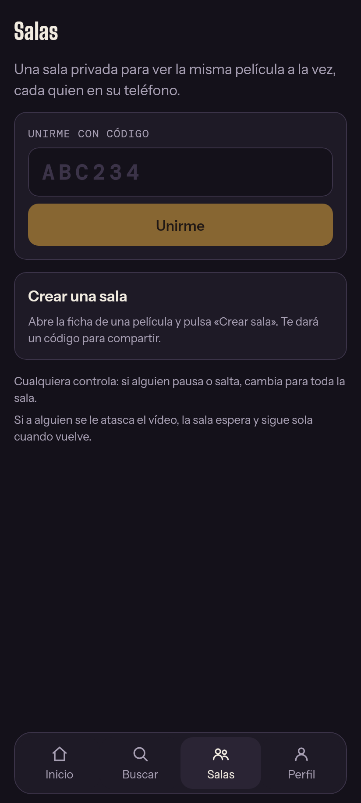
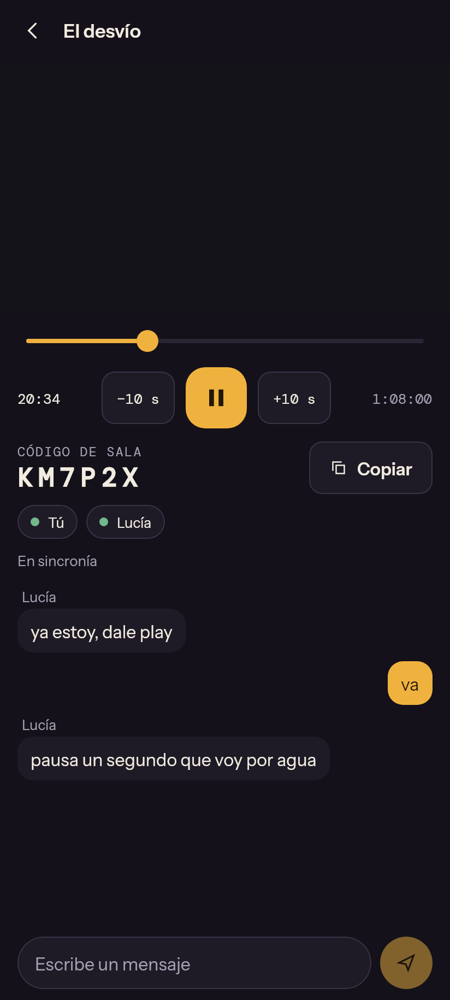

# KAMINPLAY

App Android (Kotlin + Jetpack Compose) para ver cine de dominio público, a solas o en una
sala sincronizada con otra persona. Sin anuncios. Android 12 o superior.

| Login | Inicio | Ficha | Salas | Sala |
|---|---|---|---|---|
|  |  |  |  |  |

Las capturas salen de `tools/ui-preview` (render de escritorio), no de un teléfono; el
recuadro negro es donde va el vídeo.

## Estado

- **Hecho:** login con Google, catálogo local de 22 películas, reproductor (Media3) que
  transmite desde Internet Archive, y salas con reproducción sincronizada y chat de texto.
- **Sin probar en un teléfono:** el reproductor y las salas compilan y su lógica tiene
  pruebas, pero nadie los ha ejecutado todavía en un dispositivo real con Firebase.
- **Pendiente:** catálogo TMDB, YouTube, búsqueda con IA, pantalla completa.

## Estructura

| Ruta | Qué contiene |
|---|---|
| `core/` | Kotlin puro con pruebas: catálogo y búsqueda, elección del archivo de Internet Archive, y el motor de sincronización (`sync/SyncEngine.kt`). |
| `app/.../ui/` | Pantallas y componentes Compose, sin dependencias de Android para poder renderizarlas fuera del teléfono. |
| `app/.../auth/` | Login con Google: Credential Manager + Firebase Authentication. |
| `app/.../player/` | Busca el archivo de vídeo de cada película en Internet Archive. |
| `app/.../rooms/` | Salas sobre Firebase Realtime Database. |
| `app/.../watch/` | Pantalla de reproducción: une el reproductor, el motor de sincronización y la sala. |
| `firebase/` | Reglas de seguridad de las salas y su prueba contra el emulador. |
| `tools/ui-preview/` | Build de escritorio independiente que renderiza cada pantalla a PNG. |
| `.github/workflows/android.yml` | Pruebas y APK de depuración en cada push, en cualquier rama. |

Paquete: `com.karin.kaminplay`.

## Conectar Firebase

Sin Firebase la app compila, pero el login y las salas quedan apagados (en depuración aparece
un botón para ver la interfaz sin cuenta, y se puede reproducir a solas).

1. Crea un proyecto en la consola de Firebase y añade una app Android con el paquete
   `com.karin.kaminplay`.
2. Elige el keystore con el que se firmarán **todas** las compilaciones. Si no tienes uno:

   ```bash
   keytool -genkeypair -v -keystore kaminplay.jks -alias kaminplay -keyalg RSA -keysize 2048 -validity 10000
   ```

3. Saca sus huellas y regístralas (SHA-1 y SHA-256) en la configuración de la app en Firebase:

   ```bash
   keytool -list -v -keystore kaminplay.jks -alias kaminplay
   ```

4. En Authentication, pestaña de métodos de acceso, activa Google.
5. En Realtime Database, crea la base de datos y pega en la pestaña de reglas el contenido de
   `firebase/database.rules.json`.
6. Descarga `google-services.json` **después** de los pasos 3, 4 y 5: así incluye el cliente
   web del login y la dirección de la base de datos.
7. Crea estos secretos en el repositorio de GitHub:

   | Secreto | Valor |
   |---|---|
   | `GOOGLE_SERVICES_JSON_BASE64` | `base64 -w0 google-services.json` |
   | `KEYSTORE_BASE64` | `base64 -w0 kaminplay.jks` |
   | `KEYSTORE_PASSWORD` | contraseña del keystore |
   | `KEY_ALIAS` | `kaminplay` |
   | `KEY_PASSWORD` | contraseña de la clave |

El login de Google valida la huella de la firma. Por eso el workflow firma también las
compilaciones de depuración con ese keystore: sin él, cada build tendría una huella distinta
y Google lo rechazaría.

`google-services.json` y los keystores están en `.gitignore`. No los subas al repositorio.

## Cómo se sincroniza una sala

La sala guarda un único estado: reproduciendo o en pausa, la posición y la hora del servidor
en que esa posición era cierta. Solo se escribe cuando alguien pulsa play, pausa o salta.
Cada teléfono calcula por su cuenta dónde debería ir la película con el reloj del servidor y,
cuatro veces por segundo, se corrige:

| Desfase | Corrección |
|---|---|
| Hasta 0,12 s | Ninguna. |
| Hasta 1,5 s | Acelera o frena un 5 % hasta alcanzar a la sala. |
| Más de 1,5 s | Salta a la posición de la sala, un poco por delante para compensar lo que tarda el salto. |

Cualquiera puede controlar. Si a alguien se le atasca el vídeo más de 2 segundos, su teléfono
pausa la sala y la reanuda solo cuando vuelve a tener vídeo. Salir de la app pausa solo ese
teléfono; al volver alcanza a la sala.

Para entrar hace falta el código de seis caracteres. Las reglas solo dejan leer la sala y
controlarla a quien se ha unido.

## Compilar y probar

Cada push ejecuta las pruebas de `core` en GitHub Actions y sube el APK como artefacto
`kaminplay-debug-apk`.

En local, con el SDK de Android y `google-services.json` en `app/`:

```bash
./gradlew :core:test :app:assembleDebug
```

Para firmar en local con el mismo keystore, define `KAMIN_KEYSTORE_FILE`,
`KAMIN_KEYSTORE_PASSWORD`, `KAMIN_KEY_ALIAS` y `KAMIN_KEY_PASSWORD` antes de compilar.

Reglas de la base de datos, contra el emulador de Firebase (necesita Node y Java):

```bash
cd firebase && npm --prefix rules-test install && npm --prefix rules-test test
```

Pantallas a PNG, sin teléfono (escribe en `tools/ui-preview/build/screens/`):

```bash
cd tools/ui-preview && gradle run
```

La previsualización usa una versión antigua de Compose para escritorio, así que el código de
`app/.../ui/` debe limitarse a APIs de Compose estables.

## Límites conocidos

- No hay pantalla completa ni reproducción en segundo plano.
- Dos películas del catálogo (*El chico* y *Metrópolis*) no tienen una copia verificada en las
  colecciones de dominio público de Internet Archive y solo se abren en su web.
- Las salas no se borran solas y no tienen tope de miembros.
- La calidad del vídeo es la de la copia de Internet Archive.

## Hoja de ruta

1. Proyecto base, login de Google e interfaz inicial. **Hecho.**
2. Reproductor y salas sincronizadas con chat. **Hecho, falta probarlo en dispositivo.**
3. Catálogo TMDB a través de un Cloudflare Worker que guarda las claves.
4. YouTube con su reproductor oficial embebido, también sincronizado.
5. Búsqueda inteligente con IA.
6. Pantalla completa, otros reproductores embebidos, pulido y APK de release.

## Licencias de terceros

Las tipografías (Big Shoulders Display, Instrument Sans, DM Mono) se distribuyen bajo la SIL
Open Font License; los textos y el origen de cada archivo están en `licenses/fonts/`.

Las películas del catálogo están en dominio público en Estados Unidos y el vídeo se transmite
desde las colecciones de Internet Archive. La situación cambia según el país y según la
copia: las restauraciones y las músicas nuevas pueden tener derechos propios.
