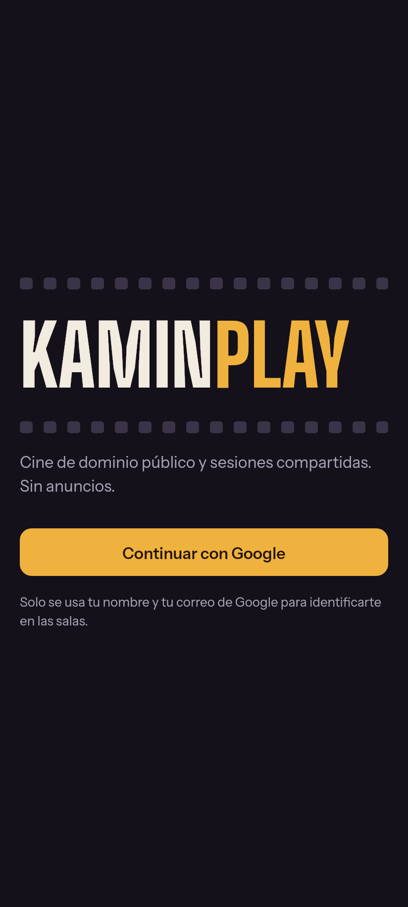
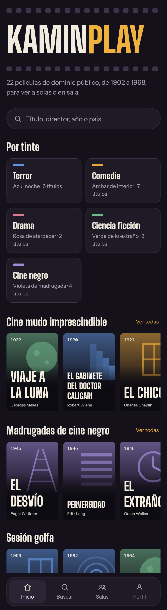
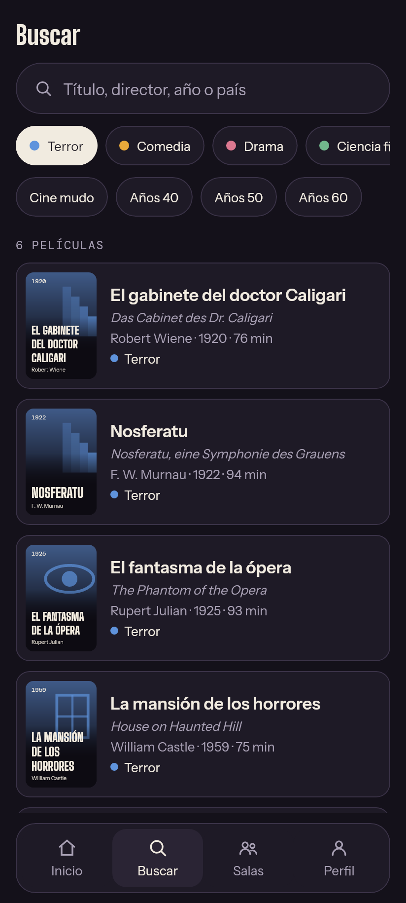
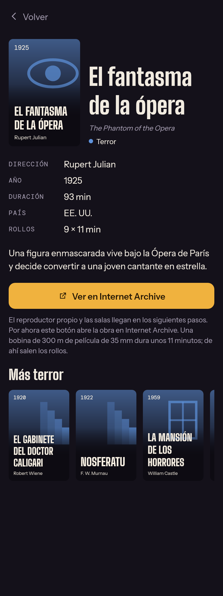

# KAMINPLAY

App Android (Kotlin + Jetpack Compose) para ver cine de dominio público y, más adelante,
verlo en sala sincronizada con otra persona. Sin anuncios. Android 12 o superior.

| Login | Inicio | Buscar | Ficha |
|---|---|---|---|
|  |  |  |  |

Las capturas salen de `tools/ui-preview` (render de escritorio), no de un teléfono.

## Estado

Paso 1 de 7: proyecto base, inicio de sesión con Google e interfaz inicial con un catálogo
local de 22 películas. Todavía no hay reproductor, salas ni catálogo de TMDB.

## Estructura

| Ruta | Qué contiene |
|---|---|
| `core/` | Kotlin puro: modelo, catálogo inicial, búsqueda. Con pruebas unitarias. |
| `app/.../ui/` | Pantallas y componentes Compose. Sin dependencias de Android, para poder renderizarlas fuera del teléfono. |
| `app/.../auth/` | Login con Google: Credential Manager + Firebase Authentication. |
| `app/.../nav/` | Puerta de sesión y navegación. |
| `tools/ui-preview/` | Build de escritorio independiente que renderiza cada pantalla a PNG. |
| `.github/workflows/android.yml` | Pruebas y APK de depuración en cada push a `main`. |

Paquete: `com.karin.kaminplay`. Nombre visible: KAMINPLAY.

## Conectar Firebase y Google

La app compila sin Firebase, pero el login queda apagado (en depuración aparece un botón
para ver la interfaz sin cuenta). Para activarlo:

1. Crea un proyecto en la consola de Firebase y añade una app Android con el paquete
   `com.karin.kaminplay`.
2. Elige el keystore con el que se firmarán **todas** las compilaciones. Si no tienes uno:

   ```bash
   keytool -genkeypair -v -keystore kaminplay.jks -alias kaminplay -keyalg RSA -keysize 2048 -validity 10000
   ```

3. Saca sus huellas y regístralas (SHA-1 y SHA-256) en la configuración de la app en Firebase:

   ```bash
   keytool -list -v -keystore kaminplay.jks -alias kaminplay
   ```

4. En Authentication, pestaña de métodos de acceso, activa Google.
5. Descarga `google-services.json` **después** de los pasos 3 y 4, para que incluya el
   cliente web que usa el login.
6. Crea estos secretos en el repositorio de GitHub:

   | Secreto | Valor |
   |---|---|
   | `GOOGLE_SERVICES_JSON_BASE64` | `base64 -w0 google-services.json` |
   | `KEYSTORE_BASE64` | `base64 -w0 kaminplay.jks` |
   | `KEYSTORE_PASSWORD` | contraseña del keystore |
   | `KEY_ALIAS` | `kaminplay` |
   | `KEY_PASSWORD` | contraseña de la clave |

El login de Google valida la huella de la firma. Por eso el workflow firma también las
compilaciones de depuración con ese keystore: sin él, cada build tendría una huella distinta
y Google lo rechazaría.

`google-services.json` y los keystores están en `.gitignore`. No los subas al repositorio.

## Compilar

En GitHub Actions: cada push a `main` ejecuta las pruebas de `core` y sube el APK como
artefacto `kaminplay-debug-apk`.

En local, con el SDK de Android instalado y `google-services.json` en `app/`:

```bash
./gradlew :core:test :app:assembleDebug
```

Para firmar en local con el mismo keystore, define `KAMIN_KEYSTORE_FILE`,
`KAMIN_KEYSTORE_PASSWORD`, `KAMIN_KEY_ALIAS` y `KAMIN_KEY_PASSWORD` antes de compilar.

## Previsualizar la interfaz sin teléfono

```bash
cd tools/ui-preview && gradle run
```

Escribe un PNG por pantalla en `tools/ui-preview/build/screens/`. Usa una versión antigua de
Compose para escritorio, así que el código de `app/.../ui/` debe limitarse a APIs de Compose
estables.

## Hoja de ruta

1. Proyecto base, login de Google e interfaz inicial. **Hecho.**
2. Catálogo TMDB a través de un Cloudflare Worker que guarda las claves.
3. Reproductor nativo (Media3) con Internet Archive.
4. Salas: sincronización de reproducción, presencia y chat de texto.
5. YouTube con su reproductor oficial embebido, también sincronizado.
6. Búsqueda inteligente con IA.
7. Otros reproductores embebidos, pulido y APK de release.

## Licencias de terceros

Las tipografías (Big Shoulders Display, Instrument Sans, DM Mono) se distribuyen bajo la SIL
Open Font License; los textos y el origen de cada archivo están en `licenses/fonts/`.

Las películas del catálogo inicial están en dominio público en Estados Unidos. La situación
cambia según el país y según la copia: las restauraciones y las músicas nuevas pueden tener
derechos propios.
